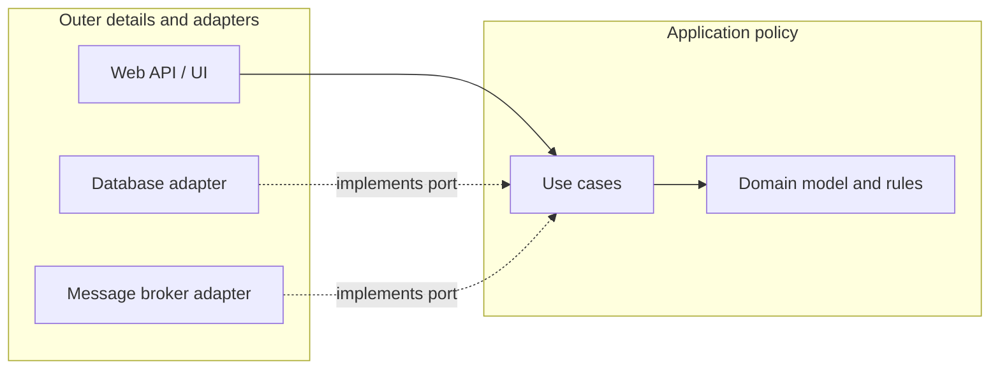

# Clean Architecture: A Practical Guide

Clean Architecture is best understood as a policy for protecting important business rules from volatile implementation details. It is not a required folder structure, a framework, or a guarantee of maintainability. Its value depends on whether the boundaries it introduces reflect real change, ownership, and testing needs.

This guide focuses on the decisions involved in applying it to production systems, including enterprise applications built with .NET, Java, and other ecosystems.

## Executive Summary

The central rule is the **Dependency Rule**: source-code dependencies point toward policies at the center. Domain rules should not depend on web frameworks, databases, message brokers, user interfaces, or vendor SDKs.

At runtime, a request can travel from an outer adapter to an inner use case and back to an outer adapter through an interface. That runtime flow does not change the compile-time dependency rule.

Clean Architecture is most useful when business rules are valuable and expected to outlive their current delivery mechanisms. It is less useful when the application is a small, short-lived CRUD tool whose complexity is mostly data access and presentation.

Do not adopt it because a diagram looks clean. Adopt it when the boundaries reduce a concrete cost: change risk, testing friction, unclear ownership, or coupling to infrastructure.

## The Dependency Rule

The names and number of rings vary between implementations. The essential constraint is that inner policy does not import outer implementation details.



A typical request works like this:

1. An HTTP controller parses transport data and invokes an application use case.
2. The use case loads or changes domain state and coordinates the operation.
3. The use case uses an output port, such as a repository interface, to request persistence.
4. An infrastructure adapter implements that port using a database, broker, or external service.
5. The outer adapter maps the result to an HTTP response or another transport format.

The controller can call the use case at runtime, but the use case must not import the controller or web framework. Likewise, a database adapter can implement an interface defined by an inner policy layer without the inner layer depending on the database library.

## What Belongs Where

### Domain model

Contains business concepts, invariants, and behavior that should remain true regardless of whether the system uses HTTP, SQL, or a particular cloud provider.

Examples include a policy that an order cannot be shipped before payment is authorized, a limit on a financial transfer, or rules for determining an eligibility decision.

Keep domain logic out of controllers, ORM callbacks, database triggers, and message handlers when that logic is a core business invariant. Not every field or record needs a rich domain object; use behavior where it makes rules clearer and harder to violate.

### Application use cases

Coordinate a user or system goal: authorize a payment, register a claim, approve a purchase, or calculate a quote. A use case defines the operation's inputs, invokes domain behavior, coordinates ports, and controls the application-level transaction boundary where appropriate.

Use cases should express intent rather than mirror every database table. They generally should not contain HTTP-specific status codes, SQL, ORM queries, or broker-specific message types.

### Ports and adapters

A port is an interface owned by the policy that needs a capability. An adapter translates between that port and an external technology or protocol.

Examples include a repository port implemented with EF Core or JPA, a payment port implemented by a vendor SDK, and an inbound HTTP adapter that invokes an application use case. Interfaces are useful when they establish a meaningful boundary; creating one for every class or method usually adds ceremony without decoupling anything important.

### Frameworks and infrastructure

Web frameworks, ORM mappings, database drivers, brokers, cloud SDKs, file systems, and external APIs are implementation details from the perspective of business policy. They belong at the system's edge and should be replaceable where that provides practical value.

"Detail" does not mean unimportant. Security, observability, resilience, consistency, and operational behavior must be designed explicitly; they simply should not force core business rules to depend on a particular vendor API.

## Clean, Hexagonal, Layered, and Related Approaches

These terms overlap, but they are not interchangeable labels for the same decision:

| Approach | Main concern | Typical use |
| --- | --- | --- |
| Layered architecture | Separating responsibilities into layers, commonly presentation, application, domain, and data | A straightforward application with clear technical responsibilities |
| Hexagonal architecture (Ports and Adapters) | Isolating application behavior from external actors and technologies through ports | Systems with several inbound or outbound integrations, or a need to test policy independently |
| Clean Architecture | Organizing source dependencies so business policy is inward and details are outward | Systems where business rules should remain independent of delivery and infrastructure choices |
| Onion Architecture | Similar inward dependency direction, emphasizing the domain at the center | Domain-centered systems; often implemented with the same practices as Clean Architecture |
| Modular monolith | Deploying as one application while enforcing explicit internal module boundaries | A strong default when independent deployment is not yet justified |
| Microservices | Separating capabilities into independently deployable and operated services | Domains with genuine autonomy, separate scaling or release needs, and teams able to operate distributed systems |
| Event-driven architecture | Communicating or reacting through events and asynchronous flows | Workflows that benefit from decoupling in time, fan-out, or eventual consistency |

Clean Architecture can be used inside a modular monolith or a microservice. It does not prescribe deployment topology, and it does not require every interaction to use a repository or an event. Event-driven design is a communication style, not a substitute for dependency boundaries.

## Example Structure

Organize around business capabilities and use cases rather than forcing every application into a universal set of projects. One possible .NET layout is:

```text
src/
  Orders.Domain/
    Order.cs
    OrderRules.cs
  Orders.Application/
    PlaceOrder/
      PlaceOrderCommand.cs
      PlaceOrderHandler.cs
    Ports/
      IOrderRepository.cs
      IPaymentGateway.cs
  Orders.Infrastructure/
    Persistence/
      EfOrderRepository.cs
    Payments/
      VendorPaymentGateway.cs
  Orders.Api/
    Endpoints/
      OrdersEndpoints.cs
```

A corresponding Java arrangement could use packages or modules rather than requiring a project per ring:

```text
com.example.orders/
  domain/
    Order.java
    OrderPolicy.java
  application/
    placeorder/PlaceOrderUseCase.java
    ports/OrderRepository.java
    ports/PaymentGateway.java
  infrastructure/
    persistence/JpaOrderRepository.java
    payments/VendorPaymentGateway.java
  api/
    OrdersController.java
```

These are examples, not mandatory templates. For a small service, keeping these packages in one build module may be simpler. For a large codebase, separate build modules can make forbidden dependencies harder to introduce, but they also increase build, versioning, and navigation overhead.

### Small .NET example

The application owns the persistence contract; the EF Core implementation depends on that contract.

```csharp
public interface IOrderRepository
{
    Task<Order?> GetAsync(OrderId id, CancellationToken cancellationToken);
    Task SaveAsync(Order order, CancellationToken cancellationToken);
}

public sealed class PlaceOrderHandler(IOrderRepository orders)
{
    public async Task<OrderId> Handle(PlaceOrder command, CancellationToken cancellationToken)
    {
        var order = Order.Place(command.CustomerId, command.Items);
        await orders.SaveAsync(order, cancellationToken);
        return order.Id;
    }
}
```

`EfOrderRepository` can implement `IOrderRepository` in an infrastructure project that references the application and domain projects. The API's composition root wires the concrete implementation into dependency injection. Avoid passing `DbContext`, `IHttpContextAccessor`, or framework request objects into the domain model or use case.

### Small Java example

The same ownership rule applies with Spring and JPA: the application defines the capability it needs, and infrastructure supplies the implementation.

```java
public interface OrderRepository {
    Optional<Order> findById(OrderId id);
    void save(Order order);
}

public final class PlaceOrderService {
    private final OrderRepository orders;

    public PlaceOrderService(OrderRepository orders) {
        this.orders = orders;
    }

    public OrderId handle(PlaceOrder command) {
        Order order = Order.place(command.customerId(), command.items());
        orders.save(order);
        return order.id();
    }
}
```

A Spring configuration class can bind a JPA adapter to this interface. The use case should not need Spring annotations simply to be invoked or tested. However, avoiding all framework usage at all costs can be counterproductive; isolate framework coupling where it matters instead of building a parallel framework of your own.

## Real-World Enterprise Scenarios

### Financial transfers

A transfer may have invariants around account status, limits, authorization, idempotency, and audit history. These rules should be testable without a live database or payment network. Adapters can integrate with the ledger, identity provider, fraud engine, and notification platform.

The architecture does not solve distributed consistency by itself. A transfer spanning separate systems still needs an explicit consistency strategy, such as a transactional outbox, a saga, reconciliation, or a clearly defined pending state. Avoid pretending that a local database transaction makes remote calls atomic.

### Government or healthcare case management

Eligibility, workflow, and audit rules may persist for years while user interfaces, vendors, and integrations change. Separating policy from transport and persistence can lower the cost of replacing a portal or integrating a new identity, document, or records provider.

In regulated environments, also design authorization, privacy, retention, auditability, data residency, and operational evidence. Clean boundaries can help locate these controls, but the architecture alone does not provide compliance.

### Enterprise product with several channels

A capability may be used by a web application, a batch import, and partner APIs. Inbound adapters can translate each protocol into application commands while reusing the same use cases. Keep channel-specific validation, authentication, rate limiting, and response semantics at the edge; keep shared business invariants in policy.

### Legacy modernization

Clean Architecture can be introduced incrementally around a high-change capability. A facade or adapter can isolate a legacy subsystem, while new use cases are implemented behind a stable boundary. Rewriting the whole system into rings before delivering business value is rarely a good first step.

## Advantages

- **Business rules are less coupled to technology.** Framework upgrades and storage changes can affect adapters without necessarily rewriting domain policy.
- **Focused testing is easier.** Use cases and domain rules can be tested without booting the web server or database, while integration tests still verify the real adapters.
- **Change impact is clearer.** A well-defined boundary makes ownership and likely blast radius easier to reason about.
- **Multiple delivery mechanisms can share policy.** HTTP, messaging, scheduled jobs, or command-line adapters can invoke the same use cases when that reuse is genuinely needed.
- **Technology choices become more reversible.** The application can replace an adapter when the cost of doing so is justified.
- **Teams can make dependencies explicit.** Project/module references and contracts can prevent infrastructure concerns from spreading into business policy.

These benefits are conditional. A codebase with many interfaces but no meaningful boundaries is not more maintainable merely because it looks decoupled.

## Disadvantages and Costs

- **More concepts and indirection.** Developers navigate through handlers, ports, adapters, mappings, and composition code to understand one operation.
- **More code and build configuration.** Separate projects and duplicated transport/persistence models add maintenance overhead.
- **Mapping can become busywork.** Mapping request DTOs to commands, domain objects, persistence records, and response DTOs is useful only when the models have distinct responsibilities or change independently.
- **Persistence can become awkward.** Rich domain models and ORM behavior do not always align. Forcing persistence ignorance can lead to fragile mapping or excessive workarounds.
- **Poor abstractions can hide important technology behavior.** A generic repository may conceal query capabilities, transaction boundaries, batching, or performance characteristics needed by the application.
- **Testing can create false confidence.** Mock-heavy unit tests may pass while SQL translation, transaction handling, serialization, or production wiring is broken.
- **The architecture can be over-applied.** A small CRUD service may pay the costs of a complex structure without gaining meaningful independence.

## Trade-Offs to Make Deliberately

### Separate projects versus packages

Use packages first when boundaries are still evolving or the system is small. Use separate projects/modules when compile-time enforcement, ownership, deployment packaging, or build isolation justifies the extra friction. A folder name alone does not enforce architecture.

### Domain model versus transaction script

Use a behavior-rich domain model when important invariants span multiple operations or are easy to violate. A transaction-script style use case can be clearer for simple workflows with little domain complexity. Do not create domain objects that only wrap fields and forward calls without protecting rules.

### Repository abstraction versus direct query technology

A repository port is useful when it expresses a business-relevant collection boundary or isolates a meaningful persistence choice. For read-heavy queries, a query service or direct projection may be simpler and faster. Avoid one generic repository abstraction for every entity by default.

### Framework independence versus pragmatic integration

Keeping policy independent from a framework is valuable when framework coupling creates real constraints. It is not necessary to hide every framework type from every edge component. Controllers, serializers, and persistence adapters are supposed to use their respective frameworks.

### Unit tests versus integration tests

Unit-test business decisions and use-case branching quickly. Integration-test database mappings, transactions, broker contracts, serialization, and dependency injection with realistic infrastructure. The goal is confidence, not maximizing the number of mocked tests.

## When to Use It

Clean Architecture is a strong candidate when several of these are true:

- Business rules are non-trivial, differentiated, or subject to frequent policy change.
- The application has multiple external integrations or delivery mechanisms.
- The system has a long expected lifetime, substantial change cost, or significant audit requirements.
- Framework or vendor coupling has already made changes risky.
- More than one team needs clear ownership of capabilities and contracts.
- Business behavior needs reliable tests independent of slow or unavailable infrastructure.
- A modular monolith needs enforced internal boundaries before considering independent deployments.

The stronger the cost of a boundary violation, the more worthwhile it is to enforce the boundary in the build and tests.

## When to Avoid It or Keep It Lightweight

Prefer a simpler structure, or apply only selected principles, when:

- The application is a small CRUD utility with little domain behavior and a short expected lifetime.
- There is one stable delivery mechanism and one uncomplicated data store.
- The team is still validating the problem and needs to optimize for fast learning.
- The proposed ports merely duplicate framework interfaces or have only one trivial implementation with no useful boundary.
- The architecture requires more ceremony than the change risk it is intended to reduce.
- The team lacks time to maintain the abstractions, module rules, and integration tests it introduces.

Avoiding Clean Architecture does not mean accepting uncontrolled coupling. A simple layered application with clear responsibilities and tests can be a better design.

## Common Failure Modes

- **Treating rings as a file-placement exercise.** The direction of source dependencies matters more than the names of folders.
- **Creating an interface for every class.** An interface is not automatically an abstraction or a useful seam.
- **Putting business rules in handlers or controllers.** Use-case orchestration and domain invariants have different responsibilities.
- **Using a generic repository for every query.** This can make data access less expressive and hide important database behavior.
- **Making the domain model persistence-proof at any cost.** Choose persistence patterns based on actual domain and ORM constraints.
- **Mocking every dependency.** Keep real adapter integration tests for behavior mocks cannot verify.
- **Splitting into microservices because of Clean Architecture.** Internal dependency direction does not imply a network boundary.
- **Sharing internal domain classes across services.** Independently deployed services should own their models and communicate through deliberate contracts.
- **Hiding transactions and consistency.** Make transaction scope, retries, idempotency, and eventual consistency explicit.
- **Building abstractions for hypothetical replacement.** Prefer boundaries tied to current variability, business ownership, or test needs.

## A Practical Adoption Path

1. Identify a business capability or workflow with meaningful change risk; do not restructure the whole application first.
2. Write down its business invariants and the external systems it depends on.
3. Extract one use case and keep its inputs, outputs, and orchestration independent of transport and persistence frameworks where practical.
4. Define only the ports that the use case needs, then implement adapters for the existing systems.
5. Add unit tests for business decisions and integration tests for persistence, messaging, and composition.
6. Enforce important dependency rules with project references, module boundaries, architecture tests, or code review checks.
7. Measure the effect on delivery speed, defect rate, change scope, and test feedback. Keep, simplify, or expand the pattern based on evidence.

## Decision Checklist

Before adopting Clean Architecture, answer these questions:

- Which business policy are we protecting, and from which concrete changes?
- What is the smallest meaningful boundary: package, module, service, or process?
- Which dependencies are genuinely volatile or difficult to test?
- Who owns each contract and adapter?
- What needs a unit test, and what must be verified with a real integration test?
- How will transactions, authorization, observability, retries, idempotency, and failure recovery work?
- What additional navigation and maintenance cost will the structure impose?
- What evidence will tell us the boundary is helping rather than slowing delivery?

If these questions have no specific answers, start with a simpler design and let the architecture emerge from real constraints.

## Further Reading in This Playbook

- [Architecture topics and index](README.md)
